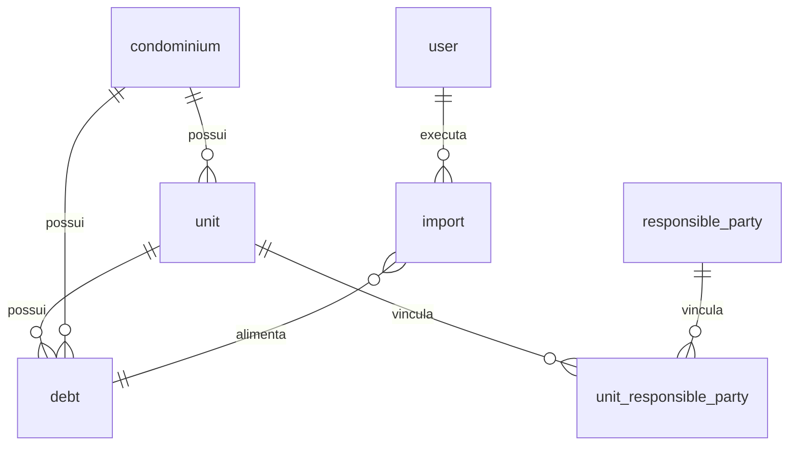

# Matriz de auditoria — importação, validação e aprovação (Fase 1 · T01)

**Épico:** Central de importação, validação e aprovação de dados  
**Ticket:** 01 — Auditoria completa das abas e funcionalidades  
**Data:** 2026-11-07  
**Escopo:** levantamento apenas — **sem alteração de regras de negócio nem implementação.**

Referências de código: menu em `src/components/workspace-shell.tsx`; mapa geral em [mapa-do-projeto.md](mapa-do-projeto.md); modelo lógico em [banco.md](banco.md); centro de importação em `src/lib/importacao-centro/` e [modulos/importacoes.md](modulos/importacoes.md).

---

## 1. Inventário de telas, abas e subáreas

| Área do menu | Rota | Tela (`src/app`) | Subáreas / painéis | Listagem / cadastro | Relacionamentos principais |
| --- | --- | --- | --- | --- | --- |
| **Início** | `/` | `page.tsx` → `DashboardHome` | Visão por perfil (Administradora, Atendente, Advogado); KPIs e atalhos | Não (agregados) | `user`, `unit`, `debt`, `service_ticket` |
| **Atendimentos** | `/atendimentos` | `atendimentos/page.tsx` + `fila-cobrancas-panel.tsx` | Fila de cobranças; filtros (incl. retorno via query `?retorno=`); painel **Distribuição automática**; sheet **Registrar contato** (palitagem); sheets negociação/histórico na fila | Fila paginada; CRUD palitagem | `unit` → `condominium`, `responsible_party`, `debt`, `collection_assignment`, `negotiation_proposal` |
| **Inadimplência** | `/debitos` | `debitos/page.tsx` | KPIs, gráfico, tabela de débitos; sheet cadastro/edição manual; quitação de unidade | `debt` | `debt` → `unit`, `condominium` |
| **Jurídico** | `/juridico` | `juridico/page.tsx` | Listagem encaminhamentos; sheet T17 | `legal_case_referral`, `legal_document` | `unit`, `debt`, `user` |
| **Condomínios** | `/condominios` | `condominios/page.tsx` | Filtros, métricas, CRUD em sheet (3 etapas) | `condominium` | `condominium` → `unit`, `debt` |
| **Unidades** | `/unidades` | `unidades/page.tsx` | Filtros, CRUD, vínculos responsável no sheet; `UnidadeDetalheSheet` + histórico | `unit`, `responsible_party`, `unit_responsible_party` | `unit` → `condominium`; responsáveis N:N |
| **Relatórios** | `/relatorios` | `relatorios/page.tsx` | Múltiplos relatórios (abas internas por tipo) | Leitura agregada | Várias tabelas (leitura) |
| **Indicadores** | `/indicadores` | `indicadores/page.tsx` | Metas e conferência | Leitura agregada | `debt`, `service_ticket` |
| **Produtividade** | `/relatorios/produtividade` | `relatorios/produtividade/page.tsx` | Tabela por RE | Leitura | `user`, `service_ticket` |
| **Importações** | `/importacoes` | `importacoes/page.tsx` | Histórico; wizard **Importar inadimplência** (arquivo → prévia → confirmação) | `import` | `import` → `debt`; auditoria |
| **Colaboradores** | `/usuarios` | `usuarios/page.tsx` | CRUD usuários | `user` → `role` | `user`, `collection_assignment` |
| **Cargos** | `/cargos` | `cargos/page.tsx` | Matriz de permissões por módulo | `role` | `role` → `user` |
| **Auditoria** | `/auditoria` | `auditoria/page.tsx` | Histórico de mutações | `audit_log` | Todas entidades mutáveis |
| **Notificações** | `/notificacoes` | `notificacoes/page.tsx` | Sino no header + lista | `internal_notification` | Links para registros |
| **Login** | `/login` | `login/page.tsx` | — | — | Sessão |
| **Integração Superlógica** | (sem rota) | — | Consumida por importações / jobs futuros | — | `debt`, `import` |

**Atalhos legados (redirecionam):** `/fila`, `/distribuicao` → `/atendimentos`; `/retornos` → `/atendimentos?retorno=hoje`.

**Negociações (T15/T16):** não há rota dedicada — sheets na fila/atendimentos; entidades `negotiation_proposal`, `agreement_installment`, `agreement_payment` ([negociacoes.md](modulos/negociacoes.md)).

---

## 2. Matriz módulo × importação (resultado principal)

Legenda **pipeline central:** fluxo `src/lib/importacao-centro/servico-central.ts` (recebimento → leitura → parse → conferência → prévia → aprovação por hash → persistência), via adaptador por módulo.

| Módulo / aba | Possui importação hoje? | Formatos (UI / código) | Entidades envolvidas | Validações / regras já existentes | Permissão típica | Pipeline central | Precisa importação no épico? |
| --- | --- | --- | --- | --- | --- | --- | --- |
| **Inadimplência (débitos)** — `/importacoes` | **Sim** — wizard com prévia e confirmação | CSV (`;`), XLS (XML Spreadsheet), XLSX, PDF* — `limites.ts` + UI | `import`, `debt`, `unit`, `condominium` | Formato `planilha-inadimplencia-v1`; mapeamento unidade/condomínio; deduplicação por hash do arquivo + ID externo ou chave natural; débito manual protegido; unidade inativa bloqueada; sem cancelar débitos ausentes no arquivo (`docs/modulos/importacoes.md`) | `importacoes.criar` (validar/confirmar); `importacoes.ler` (histórico) | **Sim** — `adaptadores/debitos.ts` + API `debitos/preview` e `confirmar` | **Padronizar** (única entrada; PDF ainda sem leitor) |
| **Inadimplência (débitos)** — `/debitos` | **Não** (apenas cadastro manual + exportação) | — | `debt` | CRUD manual + auditoria | `debitos.criar` | — | Não (origem = importação ou manual) |
| **Condomínios** — `/condominios` | **Sim** — importação **direta na tela** (sem prévia/aprovação central) | CSV (`;`), XLS (exportado pelo sistema); cliente lê texto; servidor `limites` prevê também XLSX | `condominium` | Nome; ≥1 advogado válido; `identificadorExterno` único; duplicata ignorada; escopo servidor (`condominios/service.ts`) | `condominios.criar` | Adaptador **pronto**; **sem** API preview/confirmar nem UI central | **Migrar** para centro (prévia + aprovação + histórico `import`) |
| **Unidades** — `/unidades` | **Sim** — importação **direta na tela** | CSV, XLS (idem condomínios) | `unit`, `condominium` | Condomínio resolvido por ID/nome; identificação + tipo; status/situação cobrança; duplicidade no condomínio; escopo | `unidades.criar` | Adaptador **pronto**; **sem** API/UI central | **Migrar** para centro |
| **Responsáveis / devedores** | **Não** (tipo `responsaveis` no catálogo de `import`, rótulo na UI de histórico, **sem fluxo**) | A definir: XLSX, CSV | `responsible_party`, `unit_responsible_party` | Cadastro hoje: formulário na unidade; CPF/CNPJ único (`unidades/service.ts`) | `unidades.editar` / `criar` | Não | **Sim** — novo adaptador + planilha |
| **Colaboradores (usuários)** | **Não** | Potencial: XLSX, CSV | `user`, `role` | Código único, RE único, cargo, senha, ativo | `usuarios.criar` | Não | **A avaliar** (baixa prioridade; risco LGPD) |
| **Cargos** | **Não** | — | `role` | JSON de permissões | `cargos.criar` | Não | Não |
| **Atendimentos / fila** | **Atalho apenas** — botão Importar redireciona para `/importacoes` (`importacoes.criar`) | — | — | — | `importacoes.criar` | — | Manter atalho; dados vêm de importação de débitos |
| **Distribuição / atribuições** | **Não** | — | `collection_assignment` | Atribuição manual/automática via API | `usuarios.criar` | Não | Não |
| **Palitagem (`service_ticket`)** | **Não** | — | `service_ticket` | Registro manual | `atendimentos.criar` | Não | Não |
| **Negociações / acordos** | **Não** | — | `negotiation_proposal`, parcelas, pagamentos | Fluxos API T15/T16 | `atendimentos.*` | Não | Não |
| **Jurídico** | **Não** | — | `legal_case_referral` | Encaminhamento manual | `juridico.criar` | Não | Não |
| **Relatórios / indicadores** | **Exportação** (`relatorios.exportar`), não importação | CSV, XLS, PDF (saída) | Leitura | Filtros e escopo | `relatorios.exportar` | — | Não |
| **Auditoria** | **Não** | — | `audit_log` | Somente leitura | `auditoria.ler` | — | Não |
| **Dashboard** | **Não** | — | Agregados | — | `dashboard.ler` | — | Não |
| **Integração Superlógica** | **Não implementada** (doc esboço) | API + arquivos administradora | `debt`, `import`, possivelmente cadastros | A documentar | `importacoes.criar` (provável) | Deve usar **mesmo** centro | **Sim** — leitor/adaptador ou job que alimenta o centro |

\* **PDF:** aceito no recebimento (`receber-arquivo.ts`); interpretação de linhas para débitos ainda **não** implementada ([DECISOES_PENDENTES.md](DECISOES_PENDENTES.md)).

---

## 3. Modelo de dados (PostgreSQL lógico / `catalogo.ts`)

Não há `schema.prisma` no repositório; o contrato está em [banco.md](banco.md). Entidades com impacto direto em importação:

| Tabela lógica | Papel na importação |
| --- | --- |
| `import` | Histórico: `tipo` ∈ `debitos`, `unidades`, `condominios`, `responsaveis` (previsto); contagens; `observacao_interna` (hash SHA-256, formato, relatório JSON) |
| `debt` | Destino principal da importação de inadimplência |
| `condominium` | Resolução e cadastro em lote (condomínios + referência em débitos/unidades) |
| `unit` | Resolução em débitos; destino em importação de unidades |
| `responsible_party` + `unit_responsible_party` | Futura importação de responsáveis; hoje só vínculo manual |
| `audit_log` | INSERT na confirmação (`entidade` = `import`, `debt`, etc.) |
| `role` / `user` | Autorização por módulo (`src/lib/permissions/modulos.ts`) |

---

## 4. Arquitetura atual vs requisito do épico

### 4.1 O que já existe

| Camada | Local | Situação |
| --- | --- | --- |
| Recebimento de arquivo (multipart, tamanho, assinatura, XLSX) | `src/lib/importacoes/receber-arquivo.ts`, `armazenamento-temporario.ts`, `ler-conteudo-arquivo.ts` | Implementado para `debitos`, `unidades`, `condominios` |
| Limites e formatos por módulo | `src/lib/importacoes/limites.ts` | Débitos: csv, xlsx, xls-xml, pdf |
| Orquestração central (desenho) | `servico-central.ts`, `persistencia.ts`, `historico-auditoria.ts` | Implementado no código-fonte |
| Adaptadores | `adaptadores/debitos.ts`, `condominios.ts`, `unidades.ts` | Regras de conferência/persistência prontas |
| Fachada servidor | `modulos-fachada.ts` | Preview/confirmar condomínios e unidades **sem rotas HTTP** |
| UI centralizada | `/importacoes` | Apenas **débitos** com wizard completo |
| UI legada (gravação imediata) | `/condominios`, `/unidades` | Parse no cliente + POST linha a linha **sem** `import` nem prévia central |
| Tipos de histórico | `tiposImportacao` em `catalogo.ts` | Inclui `responsaveis` — sem implementação |

### 4.2 Lacunas em relação ao épico (obrigatório: processar → validar → conferir → aprovar → gravar)

1. **Condomínios e unidades** não passam pelo centro na UI; não geram registro padronizado em `import` nem fluxo de aprovação por hash.
2. **Responsáveis** previstos no modelo, sem adaptador nem tela.
3. **PDF / layouts de administradoras** — recebimento ok; extração de dados pendente.
4. **Superlógica** — sem tela nem job; deve alimentar o mesmo pipeline.
5. **Pacote `importacao-centro` incompleto no disco:** `index.ts` e `servico-central.ts` referenciam módulos **ausentes** no diretório (`types.ts`, `leitura-arquivo.ts`, `validacao.ts`, `duplicidades.ts`, `conferencia.ts`, `aprovacao.ts`, `normalizacao.ts`). **Corrigir antes de ampliar implementação** (risco de build quebrado fora do cache `.next`).

---

## 5. Permissões por perfil (importação)

Matriz de módulos: `src/lib/permissions/modulos.ts`. Ações: `ler`, `criar`, `editar`, `excluir`, `exportar` (relatórios).

| Módulo | Ação para importar / confirmar | Observação |
| --- | --- | --- |
| `importacoes` | `criar` | Inadimplência: preview + confirmar; upload em `/api/importacoes/arquivo` |
| `importacoes` | `ler` | Histórico em `/importacoes` |
| `importacoes` | `excluir` | Excluir registro de histórico (não desfaz débitos) |
| `condominios` | `criar` | Botão Importar na listagem (fluxo legado) |
| `unidades` | `criar` | Idem |
| Atendimentos (fila) | `importacoes.criar` | Botão leva a `/importacoes` |

Perfis seed: Administrador (amplo), Atendente (operacional), Advogado (consulta) — ver `PERMISSAO_JSON_*` em `catalogo.ts` e [regra-negocio.md](regra-negocio.md).

---

## 6. Formatos de arquivo — resumo técnico

| Formato | Leitura | Onde |
| --- | --- | --- |
| CSV `;` | Sim | `lerMatrizPlanilha` / planilhas legadas |
| XLS (XML Spreadsheet) | Sim | Exportações do próprio sistema |
| XLSX (OOXML) | Sim (recebimento + leitura binária) | `ler-conteudo-arquivo.ts` |
| PDF | Recebimento e validação estrutural | Sem parser de débitos |

Colunas documentadas: débitos em [importacoes.md](modulos/importacoes.md); condomínios/unidades nos respectivos módulos e em `importar-planilha.ts`.

---

## 7. Critérios de aceite do T01 — checklist

| Critério | Atendido? |
| --- | --- |
| Nenhuma aba do menu principal fora do levantamento | Sim — 4 seções, 12 rotas funcionais + login + notificações |
| Entidades e relacionamentos identificados | Sim — seções 2 e 3 |
| Matriz apresentada antes da implementação do épico | Sim — este documento |
| Regras de negócio não alteradas nesta etapa | Sim — somente documentação |

---

## 8. Recomendações para a Fase 2 (não executadas neste ticket)

Ordem sugerida, alinhada ao mapa existente:

1. Restaurar/completar arquivos faltantes de `importacao-centro` e garantir testes verdes (`importacao-centro.test.ts`).
2. Expor APIs `preview` / `confirmar` para **condominios** e **unidades** (espelhando débitos); substituir fluxo legado nas telas.
3. Implementar adaptador **responsáveis** + tipo `responsaveis` no wizard central.
4. Unificar entrada: uma UX de “Central de importação” com seleção de módulo (ou manter `/importacoes` como hub e remover gravação direta nas abas de carteira).
5. PDF e Superlógica como adaptadores/leitores adicionais, sem pipeline paralelo.

---

## Conexões

- [mapa-do-projeto.md](mapa-do-projeto.md)
- [modulos/importacoes.md](modulos/importacoes.md)
- [banco.md](banco.md)
- [regra-negocio.md](regra-negocio.md)
- [DECISOES_PENDENTES.md](DECISOES_PENDENTES.md)
