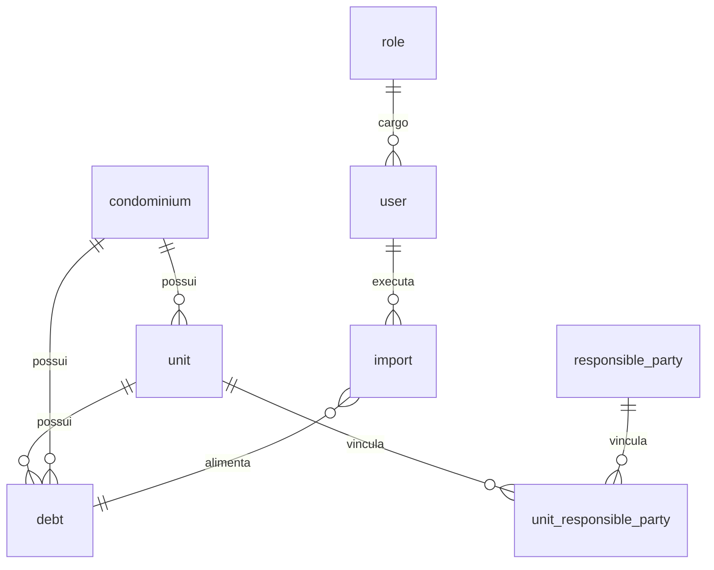

# Matriz de auditoria — importação, validação e aprovação (Fase 1 · T01)

**Épico:** Central de importação, validação e aprovação de dados  
**Ticket:** 01 — Auditoria completa das abas e funcionalidades  
**Data:** 2026-11-08 (revisão)  
**Escopo do ticket:** levantamento — **sem alteração de regras de negócio de importação.**  
**Ajuste de UI nesta revisão:** atalho **Importar** na tela `/debitos` (ao lado de **Exportar**), apontando para o wizard já existente em `/importacoes`. Não altera validações, formatos nem persistência.

Não há `schema.prisma` no repositório. O contrato de dados é o modelo lógico em [banco.md](banco.md) e os tipos em `src/data/catalogo.ts`. Persistência atual: catálogo em memória (protótipo), com APIs alinhadas ao modelo PostgreSQL.

Referências: menu em `src/components/workspace-shell.tsx`; mapa em [mapa-do-projeto.md](mapa-do-projeto.md); centro em `src/lib/importacao-centro/` e [modulos/importacoes.md](modulos/importacoes.md).

---

## 1. Inventário de telas, abas e subáreas

Nenhuma rota de `src/app/**/page.tsx` ficou de fora.

| Área | Rota | Tela | Subáreas / painéis | Listagem / cadastro | Relacionamentos principais |
| --- | --- | --- | --- | --- | --- |
| **Início** | `/` | `page.tsx` → `DashboardHome` | Visão Administradora / Atendente / Advogado; KPIs; busca global; exportação de carteira (dashboard) | Agregados | `user`, `unit`, `debt`, `service_ticket` |
| **Atendimentos** | `/atendimentos` | `atendimentos/page.tsx` | **Fila de cobranças**; filtro **retorno** (`?retorno=`); painel **operacional** (`?operacional=`); **distribuição automática** (visão geral); sheet **Registrar contato**; sheets de negociação/histórico na fila | Fila paginada; palitagem | `unit` → `condominium`, `responsible_party`, `debt`, `collection_assignment`, `negotiation_proposal` |
| **Minha agenda** | `/atendimentos?retorno=hoje` | mesma tela | Recorte da fila por retorno (hoje / atrasado / semana) | Mesma fila | idem |
| **Inadimplência** | `/debitos` | `debitos/page.tsx` | KPIs, gráfico, tabela de débitos; sheet cadastro/edição (3 etapas); quitação; **Importar** + **Exportar** | `debt` | `debt` → `unit`, `condominium` |
| **Jurídico** | `/juridico` | `juridico/page.tsx` | Listagem de encaminhamentos; sheet T17 | `legal_case_referral`, `legal_document` | `unit`, `debt`, `user` |
| **Condomínios** | `/condominios` | `condominios/page.tsx` | Filtros, métricas, CRUD em sheet (3 etapas); exportação | `condominium` | `condominium` → `unit`, `debt` |
| **Unidades** | `/unidades` | `unidades/page.tsx` | Filtros, CRUD, vínculos de responsável no sheet; detalhe + histórico; exportação | `unit`, `responsible_party`, `unit_responsible_party` | `unit` → `condominium`; responsáveis N:N |
| **Relatórios** | `/relatorios` | `relatorios/page.tsx` | Hub com 4 relatórios: **produtividade**, **retornos**, **efetividade**, **carteira e unidades** | Leitura agregada | várias (leitura) |
| **Produtividade (rota dedicada)** | `/relatorios/produtividade` | `relatorios/produtividade/page.tsx` | Tabela por RE | Leitura | `user`, `service_ticket` |
| **Importações** | `/importacoes` | `importacoes/page.tsx` | Histórico; wizard **Importar** (módulos débitos, condomínios, unidades, responsáveis); `?modulo=&abrir=1` | `import` | `import` → `debt` / cadastros; auditoria |
| **Colaboradores** | `/usuarios` | `usuarios/page.tsx` | CRUD usuários | `user` → `role` | `user`, `collection_assignment` |
| **Cargos** | `/cargos` | `cargos/page.tsx` | Matriz de permissões por módulo | `role` | `role` → `user` |
| **Auditoria** | `/auditoria` | `auditoria/page.tsx` | Histórico de mutações | `audit_log` | entidades mutáveis |
| **Notificações** | `/notificacoes` | `notificacoes/page.tsx` | Sino no header + lista | `internal_notification` | links para registros |
| **Minha conta** | `/conta` | `conta/page.tsx` | Dados do colaborador logado | `user` (próprio) | — |
| **Ajuda e suporte** | `/ajuda` | `ajuda/page.tsx` | Tópicos e atalhos | — | — |
| **Login** | `/login` | `login/page.tsx` | Autenticação | — | sessão |
| **Acesso negado** | `/acesso-negado` | `acesso-negado/page.tsx` | Sem permissão | — | — |
| **Integração Superlógica** | (sem rota) | — | Doc/esboço; origem de débito no catálogo | — | `debt`, `import` |

**Atalhos legados:** `/fila`, `/distribuicao` → `/atendimentos`; `/retornos` → `/atendimentos?retorno=hoje`.

**Negociações (T15/T16):** sem rota dedicada — sheets na fila; entidades `negotiation_proposal`, `agreement_installment`, `agreement_payment`.

**Indicadores:** tela `/indicadores` removida; API `GET /api/indicadores` permanece.

**Menu lateral** (`workspace-shell.tsx`): Início, Atendimentos, Inadimplência, Jurídico, Condomínios, Unidades, Relatórios, Colaboradores, Cargos, Auditoria; no perfil atendente também Minha agenda, Notificações, Minha conta, Ajuda. **`/importacoes` não está no menu** — entrada via atalho **Importar** (Inadimplência, fila) ou URL direta.

---

## 2. Matriz módulo × importação (resultado principal)

Legenda **pipeline central:** `src/lib/importacao-centro/servico-central.ts` (recebimento → leitura → parse → conferência → prévia → aprovação por hash → persistência), via adaptador por módulo.

| Módulo / aba | Possui importação? | Formatos aceitos | Entidades envolvidas | Validações necessárias (já no código) | Permissão | Precisa importação no épico? |
| --- | --- | --- | --- | --- | --- | --- |
| **Inadimplência** — `/debitos` | **Sim** — atalho **Importar** ao lado de **Exportar**; wizard em `/importacoes?modulo=debitos` | PDF, XLSX, CSV (`;`), XLS (XML Spreadsheet) | `import`, `debt`, `unit`, `condominium` (+ responsável no PDF Gestão Condominial) | Formato `planilha-inadimplencia-v1` ou `relatorio-inadimplencia-gestao-v1`; mapeamento unidade/condomínio; hash SHA-256; débito manual protegido; unidade inativa bloqueada; não cancela débitos ausentes do arquivo; valores persistidos sem recálculo | `importacoes.criar` (iniciar/prévia); `importacoes.editar` (corrigir/aprovar); `importacoes.ler` (histórico) | **Manter** — entrada operacional na própria aba |
| **Importações** — `/importacoes` | **Sim** — hub: débitos, condomínios, unidades, responsáveis | Conforme módulo (`limites.ts`) | `import` + entidade do módulo | Prévia obrigatória; aprovação por hash; escopo de condomínio na gravação | idem | Hub único |
| **Condomínios** — `/condominios` | **Sim no hub** (`/importacoes?modulo=condominios`); **não** há botão na listagem | XLSX, CSV (`;`), XLS | `condominium` | Nome; ≥1 advogado válido; `identificadorExterno` único; duplicata | `importacoes.criar` / `editar` | **Atalho na listagem** (opcional, mesmo padrão da inadimplência) |
| **Unidades** — `/unidades` | **Sim no hub**; **não** há botão na listagem | XLSX, CSV, XLS | `unit`, `condominium` | Condomínio por ID/nome; identificação + tipo; duplicidade no condomínio; escopo | `importacoes.criar` / `editar` | **Atalho na listagem** (opcional) |
| **Devedores / responsáveis** | **Sim no hub** (`modulo=responsaveis`); sem tela própria; cadastro também no sheet da unidade | XLSX, CSV, XLS | `responsible_party`, `unit_responsible_party`, `unit`, `condominium` | Unidade já cadastrada; CPF/CNPJ; tipo de vínculo; duplicidade | `importacoes.criar` / `editar` | **Manter** no hub; atalho em Unidades se desejado |
| **Colaboradores (usuários)** — `/usuarios` | **Não** | Potencial: XLSX, CSV | `user`, `role` | Código único, RE único, cargo, senha, ativo, e-mail | `usuarios.criar` | **A avaliar** (LGPD / autorização) |
| **Cargos** — `/cargos` | **Não** | — | `role` | JSON de permissões | `cargos.criar` | Não |
| **Atendimentos / fila** | **Atalho** — **Importar** redireciona para `/importacoes` | — | — | Dados vêm da importação de débitos | `importacoes.criar` | Manter atalho |
| **Distribuição / atribuições** | **Não** | — | `collection_assignment` | Manual/automática via API | `usuarios.criar` | Não |
| **Palitagem** | **Não** | — | `service_ticket` | Registro manual | `atendimentos.criar` | Não |
| **Negociações / acordos** | **Não** | — | `negotiation_proposal`, parcelas, pagamentos | Fluxos T15/T16 | `atendimentos.*` | Não |
| **Jurídico** | **Não** | — | `legal_case_referral` | Encaminhamento manual | `juridico.criar` | Não |
| **Relatórios** (produtividade, retornos, efetividade, carteira) | **Exportação** (`relatorios.exportar`) | CSV, XLS, PDF (saída) | Leitura | Filtros e escopo | `relatorios.exportar` | Não |
| **Auditoria** | **Não** | — | `audit_log` | Somente leitura | `auditoria.ler` | Não |
| **Dashboard / conta / ajuda / notificações** | **Não** (dashboard exporta carteira) | — | Agregados / `user` / `internal_notification` | — | `dashboard.ler` | Não |
| **Integração Superlógica** | **Não implementada** | API + arquivos da administradora | `debt`, `import` | A documentar | `importacoes.criar` (provável) | **Sim** — alimentar o mesmo centro |

---

## 3. Modelo de dados (PostgreSQL lógico)

| Tabela lógica | Papel na importação |
| --- | --- |
| `import` | Histórico: `tipo` ∈ `debitos`, `unidades`, `condominios`, `responsaveis`; hash, formato, relatório JSON |
| `debt` | Destino da importação de inadimplência |
| `condominium` | Resolução e cadastro em lote |
| `unit` | Resolução em débitos; destino da importação de unidades |
| `responsible_party` + `unit_responsible_party` | Importação de responsáveis (unidade precisa existir) |
| `audit_log` | INSERT na confirmação |
| `role` / `user` | Autorização (`src/lib/permissions/modulos.ts`) |

Relacionamentos PostgreSQL: ver diagrama completo em [banco.md](banco.md) (`service_ticket`, `negotiation_proposal`, `collection_assignment`, `legal_case_referral` **não** são destino de importação hoje).

---

## 4. Arquitetura atual

| Camada | Local | Situação |
| --- | --- | --- |
| Recebimento (multipart, tamanho, assinatura) | `receber-arquivo.ts`, `limites.ts` | Débitos: csv, xlsx, xls-xml, pdf; demais: csv, xlsx, xls-xml |
| PDF Gestão Condominial | `src/lib/importacoes/inadimplencia/` | Extração + interpretação (`relatorio-inadimplencia-gestao-v1`); outros layouts PDF pendentes |
| Orquestração | `servico-central.ts`, confirmação, prévia, duplicidades, normalização | Implementado |
| Adaptadores | `adaptadores/debitos.ts`, `condominios.ts`, `unidades.ts`, `responsaveis.ts` | Implementados |
| APIs | `/api/importacoes/{debitos,condominios,unidades,responsaveis}/preview` e `confirmar` | Implementadas |
| UI hub | `/importacoes` | Wizard dos quatro módulos |
| Atalho Inadimplência | `/debitos` botão **Importar** | Abre wizard de débitos |
| Atalho fila | `/atendimentos` botão **Importar** | Vai para `/importacoes` |
| Superlógica | — | Não implementada |

---

## 5. Permissões por perfil (importação)

Ações: `ler`, `criar`, `editar`, `excluir`, `exportar` (só relatórios). Módulo `importacoes`: consultar histórico (`ler`); envio e prévia (`criar`); correção e aprovação (`editar`); excluir histórico (`excluir`) — `src/lib/importacoes/permissoes.ts`.

Seeds: Administrador (amplo), Atendente (operacional), Advogado (consulta) — `src/lib/permissions/seeds.ts` e [regra-negocio.md](regra-negocio.md). Aprovação bloqueada para registros fora do escopo de condomínio do usuário.

---

## 6. Formatos de arquivo

| Formato | Débitos | Condomínios / unidades / responsáveis |
| --- | --- | --- |
| CSV `;` | Sim | Sim |
| XLSX | Sim | Sim |
| XLS (XML Spreadsheet) | Sim | Sim |
| PDF (Gestão Condominial / Condomínio21) | Sim (layout homologado) | Não |
| Demais PDFs de administradora | Pendente | — |

Colunas: [importacoes.md](modulos/importacoes.md) e `importar-planilha.ts` de cada módulo.

---

## 7. Critérios de aceite do T01

| Critério | Atendido? |
| --- | --- |
| Nenhuma aba do menu e nenhuma `page.tsx` fora do levantamento | Sim — seção 1 |
| Entidades e relacionamentos identificados | Sim — seções 2 e 3 |
| Matriz apresentada (este documento) | Sim |
| Regras de negócio de importação não alteradas | Sim — atalho de UI apenas |

---

## 8. Recomendações (não executadas neste ticket, salvo o atalho de `/debitos`)

1. Incluir **Importar** nas listagens de Condomínios e Unidades (mesmo padrão: `/importacoes?modulo=…&abrir=1`).
2. Colocar `/importacoes` no menu ou manter só atalhos nas abas de dados.
3. Superlógica e demais layouts PDF como leitores do mesmo pipeline.
4. Importação de colaboradores: só após decisão de LGPD.

---

## Conexões

- [mapa-do-projeto.md](mapa-do-projeto.md)
- [modulos/importacoes.md](modulos/importacoes.md)
- [modulos/debitos.md](modulos/debitos.md)
- [banco.md](banco.md)
- [regra-negocio.md](regra-negocio.md)
- [DECISOES_PENDENTES.md](DECISOES_PENDENTES.md)
