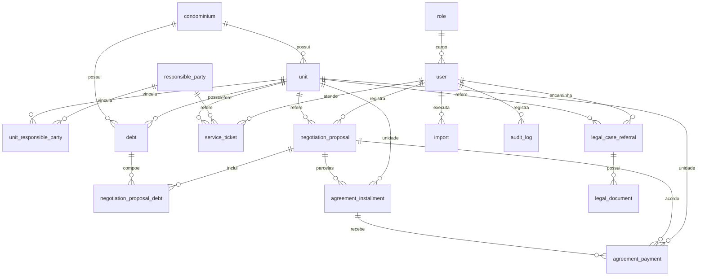

# Estrutura do banco

Modelo lógico do sistema de cobrança condominial. O desenho é genérico: os tipos abaixo valem para o motor que for escolhido. Campo JSON vira `JSONB` no PostgreSQL.

| Tabela | Papel |
| --- | --- |
| [role](#role) | Cargo e permissões |
| [user](#user) | Colaborador do sistema |
| [condominium](#condominium) | Condomínio |
| [unit](#unit) | Unidade do condomínio |
| [responsible_party](#responsible_party) | Pessoa ou empresa responsável |
| [unit_responsible_party](#unit_responsible_party) | Vínculo entre unidade e responsável |
| [debt](#debt) | Débito da unidade |
| [service_ticket](#service_ticket) | Atendimento da unidade |
| [negotiation_proposal](#negotiation_proposal) | Proposta de negociação / acordo (T15) |
| [negotiation_proposal_debt](#negotiation_proposal_debt) | Débitos vinculados à proposta |
| [agreement_installment](#agreement_installment) | Parcelas previstas do acordo confirmado (T16) |
| [agreement_payment](#agreement_payment) | Pagamentos vinculados a parcelas de acordo (T16) |
| [collection_assignment](#collection_assignment) | Responsável vigente na fila (unidade → atendente) |
| [legal_case_referral](#legal_case_referral) | Encaminhamento para análise jurídica (T17) |
| [legal_document](#legal_document) | Metadado de documento jurídico (T17) |
| [import](#import) | Importação de arquivo |
| [audit_log](#audit_log) | Auditoria de alteração |

## Diagrama

## role

Cargo do colaborador. As permissões ficam em JSON.

| Coluna | Tipo | Nulo | Restrição | Descrição |
| --- | --- | --- | --- | --- |
| id | INT | não | PK, autoincremento | |
| nome | VARCHAR(255) | sim | | Nome do cargo |
| descricao | VARCHAR(255) | sim | | |
| permissao_json | TEXT | sim | | Permissões em JSON: por módulo (`dashboard`, `atendimentos`, `debitos`, `condominios`, `unidades`, `relatorios`, `importacoes`, `usuarios`, `cargos`, `auditoria`) e ação (`ler`, `criar`, `editar`, `excluir`, `exportar` em relatórios). Ver `src/lib/permissions/modulos.ts`. |

## user

Colaborador que opera o sistema.

| Coluna | Tipo | Nulo | Restrição | Descrição |
| --- | --- | --- | --- | --- |
| id | INT | não | PK, autoincremento | |
| codigo | VARCHAR(32) | não | único | Código de login do colaborador |
| codigo_re | VARCHAR(16) | sim | único quando preenchido | RE operacional do atendente (`RE-10000` …) |
| cargo_id | INT | sim | FK → role.id | Cargo |
| nome | VARCHAR(255) | sim | | |
| telefone | VARCHAR(255) | sim | | |
| email | VARCHAR(255) | sim | | |
| senha | VARCHAR(255) | sim | | Senha |
| ativo | BOOLEAN | não | padrão `true` | Colaborador inativo não autentica; RE permanece reservado |

## condominium

Condomínio atendido.

| Coluna | Tipo | Nulo | Restrição | Descrição |
| --- | --- | --- | --- | --- |
| id | INT | não | PK, autoincremento | |
| nome | VARCHAR(255) | sim | | |
| identificador_externo | VARCHAR(255) | sim | único quando preenchido | Código da administradora ou integração |
| status | VARCHAR | não | padrão `Ativo` | Ativo, Inativo |
| advogados_json | TEXT | sim | | Lista JSON dos advogados responsáveis |
| administradora | VARCHAR(255) | sim | | Nome da administradora do condomínio |
| estado | VARCHAR(255) | sim | | |
| cidade | VARCHAR(255) | sim | | |
| cep | VARCHAR(255) | sim | | |
| logradouro | VARCHAR(255) | sim | | |
| numero | TEXT | sim | | Número do endereço |
| complemento | VARCHAR(255) | sim | | |
| observacao | TEXT | sim | | |

## unit

Unidade de um condomínio: apartamento, casa, sala ou loja.

| Coluna | Tipo | Nulo | Restrição | Descrição |
| --- | --- | --- | --- | --- |
| id | INT | não | PK, autoincremento | |
| condominio_id | INT | não | FK → condominium.id | Condomínio da unidade |
| identificacao | VARCHAR | não | | Identificação. Ex.: 101, A-302 |
| bloco | VARCHAR | sim | | Bloco ou torre |
| tipo | VARCHAR | não | | Apartamento, Casa, Sala, Loja |
| status | VARCHAR | não | padrão `Ativa` | Ativa, Inativa |
| situacao | VARCHAR | não | padrão `Sem cobrança` | Sem cobrança (fora da fila), Em cobrança, Em acordo, Notificada, Ajuizada, Quitada |

## responsible_party

Pessoa física ou jurídica ligada às unidades.

| Coluna | Tipo | Nulo | Restrição | Descrição |
| --- | --- | --- | --- | --- |
| id | INT | não | PK, autoincremento | |
| nome | VARCHAR | não | | Nome ou razão social |
| cpf_cnpj | VARCHAR | não | único | CPF ou CNPJ |
| tipo_pessoa | VARCHAR | não | | Fisica, Juridica |
| telefone | VARCHAR | sim | | Telefone principal |
| whatsapp | VARCHAR | sim | | |
| email | VARCHAR | sim | | |
| endereco | TEXT | sim | | Endereço completo em JSON |
| observacoes | TEXT | sim | | |

## unit_responsible_party

Vínculo de muitos para muitos entre unidade e responsável.

| Coluna | Tipo | Nulo | Restrição | Descrição |
| --- | --- | --- | --- | --- |
| id | INT | não | PK, autoincremento | |
| unidade_id | INT | não | FK → unit.id | |
| responsavel_id | INT | não | FK → responsible_party.id | |
| tipo_vinculo | VARCHAR | não | | Proprietario, Inquilino, Administrador, Sindico |
| principal | BOOLEAN | sim | padrão `true` | Responsável principal do vínculo |
| observacoes | TEXT | sim | | |

## debt

Débito ou encargo de uma unidade.

| Coluna | Tipo | Nulo | Restrição | Descrição |
| --- | --- | --- | --- | --- |
| id | INT | não | PK, autoincremento | |
| condominio_id | INT | não | FK → condominium.id | |
| unidade_id | INT | não | FK → unit.id | Unidade de origem |
| referencia | VARCHAR | não | | Referência da cobrança. Ex.: 09/2026 |
| descricao | VARCHAR | sim | | |
| data_vencimento | DATE | não | | |
| valor | DECIMAL(12,2) | sim | | Valor cobrado antes dos acréscimos |
| valor_original | DECIMAL(12,2) | sim | | |
| multa | DECIMAL(12,2) | sim | | |
| juros | DECIMAL(12,2) | sim | | |
| correcao | DECIMAL(12,2) | sim | | |
| valor_atualizado | DECIMAL(12,2) | sim | | |
| status | VARCHAR | não | | Pendente, Pago, Vencido, Cancelado |
| data_pagamento | DATE | sim | | Data do pagamento, quando houver |
| valor_pago | DECIMAL(12,2) | sim | | Valor efetivamente pago |
| origem | VARCHAR | sim | | Superlógica, PDF ou outra administradora |
| identificador_externo | VARCHAR | sim | | ID ou código vindo da administradora |
| atualizado_em | TIMESTAMP | sim | | Última persistência (importação ou correção manual) |
| fonte_valores | VARCHAR | sim | | `origem` (valores da administradora) ou `manual` (correção no sistema; sem recálculo automático de encargos) |

## collection_assignment

Histórico de responsáveis pela cobrança na fila operacional. Vigência: `encerrado_em` nulo. Protótipo: `AtribuicaoCobranca` em `catalogo.ts`; gestão manual via T09 (`src/lib/distribuicao/service.ts`, `/api/distribuicao/*`).

| Coluna | Tipo | Nulo | Descrição |
| --- | --- | --- | --- |
| id | INT | não | PK |
| unidade_id | INT | não | FK → unit.id |
| atendente_id | INT | não | FK → user.id |
| atribuido_por_id | INT | não | FK → user.id |
| atribuido_em | TIMESTAMP | não | Início da vigência |
| encerrado_em | TIMESTAMP | sim | Fim (redistribuição) |
| motivo | TEXT | sim | |
| anterior_atendente_id | INT | sim | FK → user.id |

## service_ticket

Atendimento (palitagem) de uma unidade. Quem registra é o colaborador logado.

| Coluna | Tipo | Nulo | Restrição | Descrição |
| --- | --- | --- | --- | --- |
| id | UUID | não | PK | |
| unidade_id | INT | não | FK → unit.id | |
| responsavel_id | INT | sim | FK → responsible_party.id | |
| usuario_id | INT | não | FK → user.id | Atendente |
| data_hora | TIMESTAMP | não | | |
| canal | VARCHAR | sim | | WhatsApp, Telefone, E-mail, SMS, Presencial, Carta/notificação |
| respondeu | VARCHAR | sim | | Sim / Não — houve resposta do condômino ou administradora |
| motivo | VARCHAR | sim | | Motivo da pendência (catálogo em `motivosPendencia`) quando respondeu = Sim |
| assunto | VARCHAR | sim | | |
| descricao | TEXT | sim | | Observações |
| status | VARCHAR | não | | Resolvido, Pendente |
| data_proxima_acao | DATE | sim | | Data prevista para a próxima ação |
| proxima_acao | VARCHAR | sim | | Próxima ação a executar |
| retorno_concluido_em | TIMESTAMP | sim | | Data/hora em que o retorno agendado foi marcado como realizado |
| retorno_concluido_por_id | INT | sim | FK → user.id | Quem marcou o retorno como realizado |

## legal_case_referral

Encaminhamento de cobrança para análise jurídica (T17). Não dispara ajuizamento. Protótipo: `EncaminhamentoJuridico` em `catalogo.ts`; API `/api/juridico/encaminhamentos`.

| Coluna | Tipo | Nulo | Restrição | Descrição |
| --- | --- | --- | --- | --- |
| id | UUID | não | PK | |
| condominio_id | INT | não | FK → condominium.id | |
| unidade_id | INT | não | FK → unit.id | |
| usuario_id | INT | não | FK → user.id | Autor do encaminhamento |
| encaminhado_em | TIMESTAMP | não | | |
| status | VARCHAR | não | | Estados provisórios (catálogo em `statusEncaminhamentoJuridico`) |
| advogado_responsavel | VARCHAR | não | | Nome do advogado vinculado ao condomínio |
| observacoes | TEXT | sim | | |
| debito_ids_json | TEXT | sim | | Lista JSON de IDs de débitos |
| resumo_contexto | TEXT | sim | | Snapshot textual do caso |
| atualizado_em | TIMESTAMP | não | | |
| atualizado_por_id | INT | não | FK → user.id | |

## legal_document

Metadado de documento ligado ao encaminhamento (referência interna; sem envio a tribunais). Protótipo: `DocumentoJuridico` em `catalogo.ts`.

| Coluna | Tipo | Nulo | Restrição | Descrição |
| --- | --- | --- | --- | --- |
| id | UUID | não | PK | |
| encaminhamento_id | UUID | não | FK → legal_case_referral.id | |
| titulo | VARCHAR | não | | |
| descricao | TEXT | sim | | |
| referencia_arquivo | VARCHAR | sim | | Pasta, caminho ou identificador interno |
| registrado_em | TIMESTAMP | não | | |
| registrado_por_id | INT | não | FK → user.id | |

## negotiation_proposal

Proposta de negociação (T15). Não representa pagamento recebido. Protótipo: `PropostaNegociacao` em `catalogo.ts`; API `/api/propostas`.

| Coluna | Tipo | Nulo | Restrição | Descrição |
| --- | --- | --- | --- | --- |
| id | UUID | não | PK | |
| condominio_id | INT | não | FK → condominium.id | |
| unidade_id | INT | não | FK → unit.id | |
| usuario_id | INT | não | FK → user.id | Autor da proposta |
| criado_em | TIMESTAMP | não | | Data/hora do registro |
| status | VARCHAR | não | | Em análise, Aceita, Recusada, Cancelada |
| valor_proposto | DECIMAL(12,2) | não | | Valor total proposto (sem recálculo automático de encargos) |
| observacoes | TEXT | sim | | |
| acordo_confirmado_em | TIMESTAMP | sim | | Preenchido quando status = Aceita |
| acordo_confirmado_por_id | INT | sim | FK → user.id | Quem confirmou o acordo |
| termos_aprovados | TEXT | sim | | Termos textuais do acordo confirmado |

## agreement_installment

Parcelas do cronograma após acordo confirmado (proposta **Aceita**). Valor **previsto** — não representa recebimento. Protótipo: `ParcelaAcordo` em `catalogo.ts`; API `POST/GET /api/propostas/:id/parcelas`.

| Coluna | Tipo | Nulo | Restrição | Descrição |
| --- | --- | --- | --- | --- |
| id | UUID | não | PK | |
| proposta_id | UUID | não | FK → negotiation_proposal.id | Acordo de origem |
| condominio_id | INT | não | FK → condominium.id | |
| unidade_id | INT | não | FK → unit.id | |
| numero | INT | não | único por proposta | Número da parcela |
| valor_previsto | DECIMAL(12,2) | não | | Valor previsto da parcela |
| vencimento_em | DATE | não | | Data de vencimento |
| criado_em | TIMESTAMP | não | | |
| criado_por_id | INT | não | FK → user.id | |

Status operacional (**Prevista**, **Vencida**, **Quitada**) é calculado em `src/lib/acordos/resumo.ts` a partir de vencimento e pagamentos **Confirmados**.

## agreement_payment

Pagamento informado ou confirmado contra uma parcela. Não altera automaticamente `debt.status`. Protótipo: `PagamentoAcordo` em `catalogo.ts`; API `POST/GET /api/propostas/:id/pagamentos`, correção `PATCH /api/pagamentos-acordo/:id`.

| Coluna | Tipo | Nulo | Restrição | Descrição |
| --- | --- | --- | --- | --- |
| id | UUID | não | PK | |
| proposta_id | UUID | não | FK → negotiation_proposal.id | |
| parcela_id | UUID | não | FK → agreement_installment.id | |
| unidade_id | INT | não | FK → unit.id | |
| valor | DECIMAL(12,2) | não | | |
| data_pagamento | TIMESTAMP | não | | Data informada do pagamento |
| referencia_comprovante | VARCHAR | sim | | Referência ou comprovante |
| confirmacao | VARCHAR | não | | Informado ou Confirmado |
| criado_em | TIMESTAMP | não | | |
| registrado_por_id | INT | não | FK → user.id | |

## negotiation_proposal_debt

Associação N:N entre proposta e débitos cobertos pela tratativa.

| Coluna | Tipo | Nulo | Restrição | Descrição |
| --- | --- | --- | --- | --- |
| id | INT | não | PK, autoincremento | |
| proposta_id | UUID | não | FK → negotiation_proposal.id | |
| debito_id | INT | não | FK → debt.id | Débito da mesma unidade |

## import

Histórico de importação de arquivos: débitos, unidades, responsáveis e outros.

| Coluna | Tipo | Nulo | Restrição | Descrição |
| --- | --- | --- | --- | --- |
| id | INT | não | PK, autoincremento | |
| origem | VARCHAR | sim | | Administradora ou formato. Ex.: Superlógica, PDF |
| tipo | VARCHAR | não | | debitos, responsaveis, unidades |
| arquivo | VARCHAR | sim | | Nome ou caminho do arquivo |
| status | VARCHAR | não | | Processando, Concluida, Erro, Cancelada |
| quantidade_registros | INT | sim | | |
| quantidade_importados | INT | sim | | |
| quantidade_atualizados | INT | sim | | |
| quantidade_erros | INT | sim | | |
| observacao_interna | TEXT | sim | | JSON opcional: `hashArquivo`, `formato` (ex. `planilha-inadimplencia-v1`), `relatorio` com erros/ignorados |
| usuario_id | INT | não | FK → user.id | Quem executou a importação |
| data_importacao | TIMESTAMP | não | | |

## audit_log

Registro de cada alteração feita no sistema.

| Coluna | Tipo | Nulo | Restrição | Descrição |
| --- | --- | --- | --- | --- |
| id | INT | não | PK, autoincremento | |
| usuario_id | INT | sim | FK → user.id | Colaborador que realizou a ação |
| entidade | VARCHAR | não | | Tabela afetada. Ex.: debt, unit |
| registro_id | VARCHAR | sim | | ID do registro afetado |
| acao | VARCHAR | não | | INSERT, UPDATE, DELETE |
| dados_anteriores | TEXT | sim | | Estado antes da alteração, em JSON |
| dados_novos | TEXT | sim | | Estado depois da alteração, em JSON |
| campos_alterados | TEXT | sim | | Campos modificados |
| ip | VARCHAR | sim | | |
| user_agent | VARCHAR | sim | | |
| data_hora | TIMESTAMP | não | | |

## Relacionamentos

| De | Para | Cardinalidade | Coluna |
| --- | --- | --- | --- |
| user | role | muitos para um | cargo_id |
| unit | condominium | muitos para um | condominio_id |
| unit_responsible_party | unit | muitos para um | unidade_id |
| unit_responsible_party | responsible_party | muitos para um | responsavel_id |
| debt | condominium | muitos para um | condominio_id |
| debt | unit | muitos para um | unidade_id |
| service_ticket | unit | muitos para um | unidade_id |
| negotiation_proposal | unit | muitos para um | unidade_id |
| negotiation_proposal | user | muitos para um | usuario_id |
| negotiation_proposal_debt | negotiation_proposal | muitos para um | proposta_id |
| negotiation_proposal_debt | debt | muitos para um | debito_id |
| agreement_installment | negotiation_proposal | muitos para um | proposta_id |
| agreement_installment | unit | muitos para um | unidade_id |
| agreement_payment | agreement_installment | muitos para um | parcela_id |
| agreement_payment | negotiation_proposal | muitos para um | proposta_id |
| agreement_payment | unit | muitos para um | unidade_id |
| legal_case_referral | unit | muitos para um | unidade_id |
| legal_case_referral | condominium | muitos para um | condominio_id |
| legal_case_referral | user | muitos para um | usuario_id |
| legal_document | legal_case_referral | muitos para um | encaminhamento_id |
| service_ticket | responsible_party | muitos para um | responsavel_id |
| service_ticket | user | muitos para um | usuario_id |
| import | user | muitos para um | usuario_id |
| audit_log | user | muitos para um | usuario_id |
