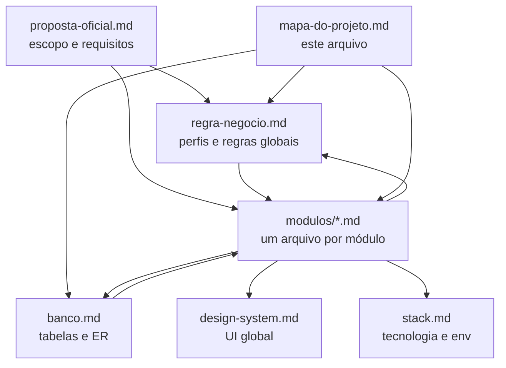
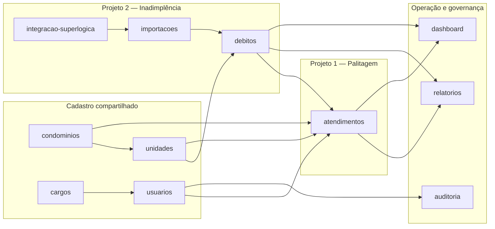
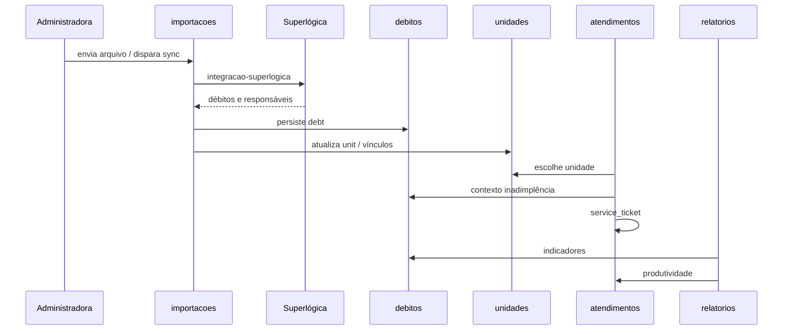

# Mapa do projeto

**Hub central:** liga requisitos, módulos, telas, dados, regras e integrações. Toda implementação deve **manter este mapa e os links entre pontos atualizados** (ver `.agents/skills/_shared/documentacao-modulo.md`).

## Como navegar a documentação

| Ponto de partida | Use quando |
| --- | --- |
| [Proposta oficial](proposta-oficial.md) | Entender *o quê* o cliente pediu (Projeto 1 palitagem, Projeto 2 inadimplência) |
| [Regras de negócio](regra-negocio.md) | Perfis, permissões, fluxos transversais, princípio “um sistema só” |
| [Módulos](modulos/README.md) | Detalhe por área funcional (rotas, fluxos, API) |
| [Banco](banco.md) | Tabelas, FKs, entidades persistidas |
| [Design system](design-system.md) | Componentes e padrões de tela |
| [Stack](stack.md) | Next.js, dependências, variáveis de ambiente |

---

## Visão do produto (dois projetos, um sistema)

**Princípio:** não há “processo de cobrança” separado — [atendimentos](modulos/atendimentos.md) registra cobrança sobre [unidade](modulos/unidades.md) / [débito](modulos/debitos.md) do [condomínio](modulos/condominios.md). Ver [regra-negocio.md](regra-negocio.md).

---

## Mapa módulo → código → dados → documentos

Atualizar esta tabela quando criar rota, tela, tipo em `catalogo`, tabela no banco ou endpoint.

| Slug | Rota | Tela (`src/app`) | Doc módulo | Tipos mock (`src/data/catalogo.ts`) | Tabelas (`docs/banco.md`) | Módulos relacionados |
| --- | --- | --- | --- | --- | --- | --- |
| dashboard | `/` | `page.tsx` | [dashboard.md](modulos/dashboard.md) | agregados de várias entidades | — | atendimentos, debitos, relatorios |
| atendimentos | `/atendimentos` | `atendimentos/page.tsx`, `fila-cobrancas-panel.tsx`, `distribuicao-panel.tsx` | [atendimentos.md](modulos/atendimentos.md) | `Atendimento`, `AtribuicaoCobranca`, `PropostaNegociacao`, `ParcelaAcordo`, `PagamentoAcordo` | `service_ticket`, `collection_assignment`, `negotiation_proposal`, `negotiation_proposal_debt`, `agreement_installment`, `agreement_payment`, `debt`, `user`, `unit` | condominios, unidades, debitos, [negociacoes](modulos/negociacoes.md), usuarios; API `/api/fila`, `/api/atendimentos`, `/api/propostas`, `/api/propostas/:id/parcelas`, `/api/propostas/:id/pagamentos`, `/api/distribuicao/*` |
| debitos | `/debitos` | `debitos/page.tsx` | [debitos.md](modulos/debitos.md) | `Debito` | `debt`, `unit`, `condominium` | unidades, importacoes, atendimentos, relatorios; API `/api/debitos`, `/api/debitos/indicadores`, `src/lib/debitos/*` |
| condominios | `/condominios` | `condominios/page.tsx` | [condominios.md](modulos/condominios.md) | `Condominio` | `condominium` | unidades, debitos, atendimentos |
| unidades | `/unidades` | `unidades/page.tsx`, `components/unidade-detalhe-sheet.tsx` | [unidades.md](modulos/unidades.md) | `Unidade`, `Responsavel`, `Vinculo` | `unit`, `responsible_party`, `unit_responsible_party` | condominios, debitos, atendimentos; API `/api/unidades` |
| importacoes | `/importacoes` | `importacoes/page.tsx` | [importacoes.md](modulos/importacoes.md) | `Importacao`, `Debito` | `import`, `debt` | integracao-superlogica, debitos, unidades; API `/api/importacoes`, `/api/importacoes/debitos/*`, `src/lib/importacoes/*` |
| relatorios | `/relatorios` | `relatorios/page.tsx` | [relatorios.md](modulos/relatorios.md) | leitura de cadastros | várias (leitura) | atendimentos, debitos, condominios |
| usuarios | `/login`, `/usuarios` | `login/page.tsx`, `usuarios/page.tsx` | [usuarios.md](modulos/usuarios.md) | `Usuario`; sessão `useAuth` | `user` | cargos, atendimentos, auditoria; API `/api/usuarios`, `src/lib/usuarios/*`, `/api/auth/*` |
| cargos | `/cargos`, `/acesso-negado` | `cargos/page.tsx`, `lib/permissions/*`, `middleware.ts` | [cargos.md](modulos/cargos.md) | `Cargo` | `role` | usuarios, regra-negocio (permissões), todas as rotas autenticadas |
| auditoria | `/auditoria` | `auditoria/page.tsx` | [auditoria.md](modulos/auditoria.md) | `Auditoria` | `audit_log` (futuro PG) | todos os módulos com mutação; API `GET /api/auditoria`, `src/lib/auditoria/*` |
| integracao-superlogica | — | (a definir em `src/lib` / API) | [integracao-superlogica.md](modulos/integracao-superlogica.md) | `origensDebito` | `debt`, `import` | importacoes, debitos |

**Shell de navegação:** menu lateral em `src/components/workspace-shell.tsx` (rotas acima).

**Autenticação:** `src/proxy.ts`, `src/lib/auth/*`, `src/app/api/auth/*`, `src/context/auth-context.tsx`. Rotas da aplicação exigem cookie `lc_session`, exceto `/login` e `/api/auth/*`.

**Estado em memória (protótipo):** `getCadastros` / `set*` em `src/data/catalogo.ts` — substituir por API/PostgreSQL conforme [stack.md](stack.md) e skill `make-functional`.

---

## Rastreio requisito → módulo

| Trecho da proposta | Módulos |
| --- | --- |
| §2 Palitagem / registro de atendimento | atendimentos, condominios, unidades, usuarios |
| T08 Fila de cobranças | atendimentos (aba fila), `/api/fila`, debitos, unidades |
| T09 Distribuição / redistribuição | atendimentos (aba distribuição), `/api/distribuicao/*`, `collection_assignment` |
| T10 Registrar tentativa de cobrança | atendimentos (sheet palitagem), `/api/atendimentos`, `service_ticket` |
| T11 Agenda e conclusão de retorno | atendimentos (aba retornos), `/api/retornos`, `POST …/concluir-retorno`, campos `retorno_concluido_*` em `service_ticket` |
| T12 Histórico completo da unidade | unidades (`UnidadeDetalheSheet`), atendimentos (fila → `HistoricoUnidadeSheet`), `/api/unidades/:id/historico`, `src/lib/historico-unidade/service.ts` |
| T13 Importação de inadimplência | importacoes (wizard), `/api/importacoes/debitos/preview`, `/api/importacoes/debitos/confirmar`, `debitos`, unidades, condomínios |
| T14 Gestão de débitos e inadimplência | `/debitos`, `/api/debitos`, `/api/debitos/indicadores`, quitação de unidade, `src/lib/debitos/*`, importacoes |
| T15 Proposta de negociação e acordo | `/api/propostas`, `PropostaNegociacaoSheet`, `src/lib/negociacoes/*`, linha do tempo, [negociacoes.md](modulos/negociacoes.md) |
| T16 Parcelas, pagamentos e acordos | `/api/propostas/:id/parcelas`, `/api/propostas/:id/pagamentos`, `AcordoAcompanhamentoBlock`, `src/lib/acordos/*`, `agreement_installment`, `agreement_payment`, [negociacoes.md](modulos/negociacoes.md) |
| §2.2 Permissões | cargos, usuarios, [regra-negocio.md](regra-negocio.md) |
| §2.5 Alertas de retorno | atendimentos, dashboard |
| Relatórios e gráficos | relatorios, atendimentos, debitos |
| Projeto 2 / Superlógica | integracao-superlogica, importacoes, debitos |
| Cadastro condomínios e unidades | condominios, unidades |
| Correção com histórico | auditoria, atendimentos |

Ao implementar um item da [proposta-oficial.md](proposta-oficial.md), atualizar o módulo correspondente **e** esta tabela se surgir novo vínculo.

---

## Fluxo de dados (cadastro → débito → cobrança)

---

## Checklist ao encerrar qualquer implementação

1. [ ] `docs/modulos/<slug>.md` atualizado, incluindo seção **Conexões**
2. [ ] `docs/regra-negocio.md` / `docs/banco.md` / `docs/stack.md` se aplicável
3. [ ] **Esta página:** linha na tabela “Mapa módulo → código → dados” se mudou rota, arquivo, tabela ou dependência
4. [ ] Links entre documentos bidirecionais (módulo aponta para banco/regra; mapa reflete o módulo)
5. [ ] `docs/modulos/README.md` se módulo novo

Implementação sem mapa e conexões documentadas = **entrega incompleta**.
